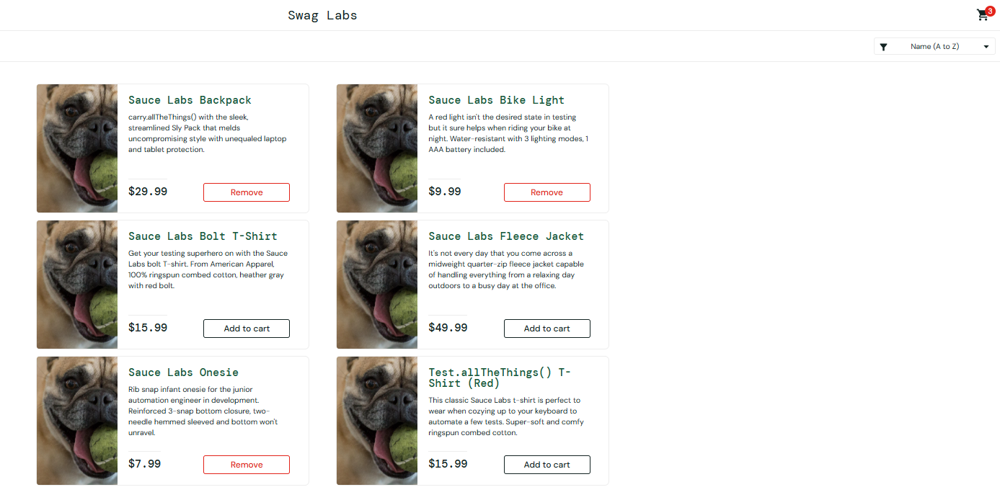

# BUG-04: Produtos que não puderam ser adicionados no carrinho

- **Status:** Aberto
- **Ambiente:** saucedemo.com, Chrome (Versão 156.0.8078.76 (Versão oficial) 64 bits), Windows 11
- **Pré-condições:** usuário `problem_user` logado (senha `secret_sauce`)
- **Severidade:** Alta (alta: o defeito afeta todos os usuários, fazendo ter uma ma experiencia da plataforma)
- **Prioridade:** Alta
- **Relacionado:** VF-22

## Passos para reproduzir
1. Abrir saucedemo.com.
2. Fazer login com `problem_user` / `secret_sauce`.
3. Localizar o card dos produtos (Sauce Labs Bolt T-Shirt, Sauce Labs Fleece Jacket e Test.allTheThings() T-Shirt (Red)).

## Resultado esperado
Item adicionado e contador correto

## Resultado obtido
Três itens não puderam ser adicionados (Sauce Labs Bolt T-Shirt, Sauce Labs Fleece Jacket e Test.allTheThings() T-Shirt (Red)). Os demais entraram e o contador acompanhou a quantidade. A remoção não funcionou na listagem principal, apenas dentro do carrinho.

## Evidência
