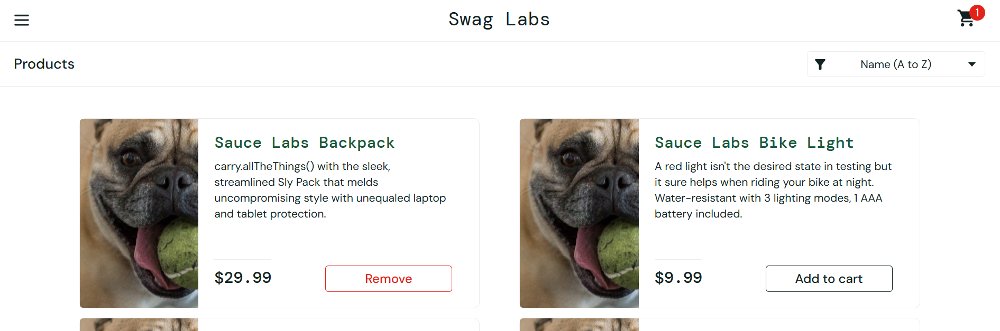

# BUG-05: Remoção travada na listagem principal para problem_user

- **Status:** Aberto
- **Ambiente:** saucedemo.com, Chrome (Versão 156.0.8078.76 (Versão oficial) 64 bits), Windows 11
- **Pré-condições:** usuário `problem_user` logado, com Sauce Labs Backpack no carrinho
- **Severidade:** Média (o item não sai do carrinho pela listagem, mas pode ser removido pela tela do carrinho)
- **Prioridade:** Média
- **Relacionado:** VF-32

## Passos para reproduzir
1. Fazer login com `problem_user` / `secret_sauce`.
2. Clicar em "Add to cart" no Sauce Labs Backpack.
3. Clicar em "Remove" no mesmo card, na listagem principal.

## Resultado esperado
Item removido, botão volta para "Add to cart" e o contador é atualizado.

## Resultado obtido
O item não pode ser removido pela tela da listagem principal 

## Evidência
