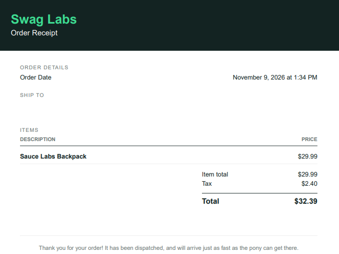

# BUG-06: Checkout com campos de espaços

- **Status:** Aberto
- **Ambiente:** saucedemo.com, Chrome (Versão 156.0.8078.76 (Versão oficial) 64 bits), Windows 11
- **Pré-condições:** usuário standard_user logado, com 1 item no carrinho
- **Severidade:** Alta (Cliente ou endereço não identificados podem resultar na não entrega do produto ou aumento de cancelamentos)
- **Prioridade:** Alta
- **Relacionado:** Exploratório, sessão 1

## Passos para reproduzir
1. Fazer login com `standard_user` / `secret_sauce`.
2. Clicar em "Add to cart" em um produto.
3. Clicar no ícone de carrinho.
4. Clicar em Checkout
5. Preencher os campos First Name = "   ", Last Name = "   ", Postal Code = "   ".
6. Clicar em continue 
7. clicar em Finish

## Resultado esperado
O sistema deve recusar os campos com mensagem de obrigatório, por exemplo ‘Error: First Name is required’, e não avançar.

## Resultado obtido
Com os três campos só com espaços, ao clicar em Continue a tela avançou para ‘Checkout: Overview’, sem mensagem de erro

## Evidência
