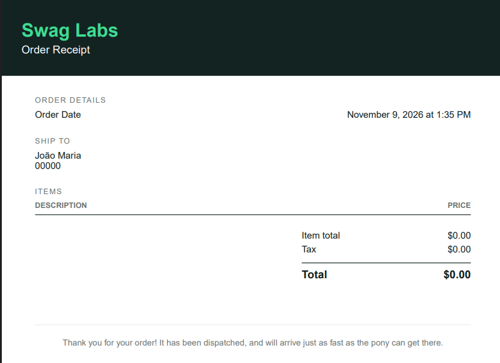

# BUG-08: Checkout concluído com carrinho vazio

- **Status:** Aberto
- **Ambiente:** saucedemo.com, Chrome (Versão 156.0.8078.76, 64 bits), Windows 11
- **Pré-condições:** usuário `standard_user` logado, com carrinho vazio (0 itens)
- **Severidade:** Alta: permite concluir pedidos sem produtos, gerando registros de compra inválidos
- **Prioridade:** Alta
- **Relacionado:** Exploratório, sessão 3

## Passos para reproduzir
1. Fazer login com `standard_user` / `secret_sauce`.
2. Abrir o carrinho sem adicionar itens.
3. Clicar em "Checkout".
4. Preencher First Name = `jose`, Last Name = `Maria` e Postal Code = `00000`.
5. Clicar em "Continue".
6. Clicar em "Finish".

## Resultado esperado
O sistema deve bloquear o checkout com carrinho vazio, exibindo mensagem de erro e não permitindo concluir o pedido.

## Resultado obtido
O sistema avançou para "Checkout: Your Information", depois para "Checkout: Overview" e, ao clicar em "Finish", exibiu "Checkout: Complete!". Nenhuma mensagem de erro foi exibida.

## Evidência
