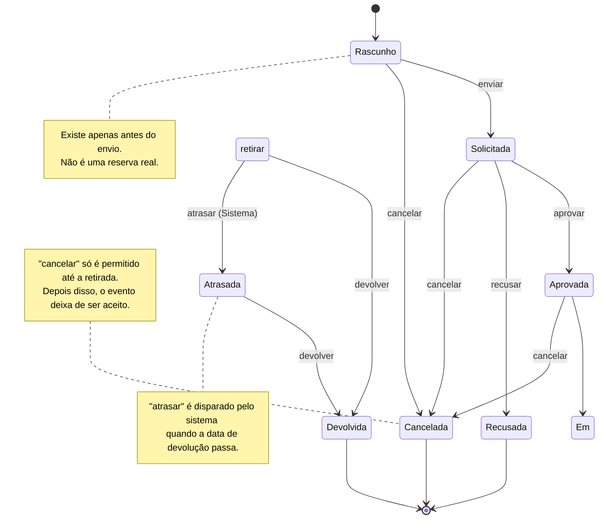
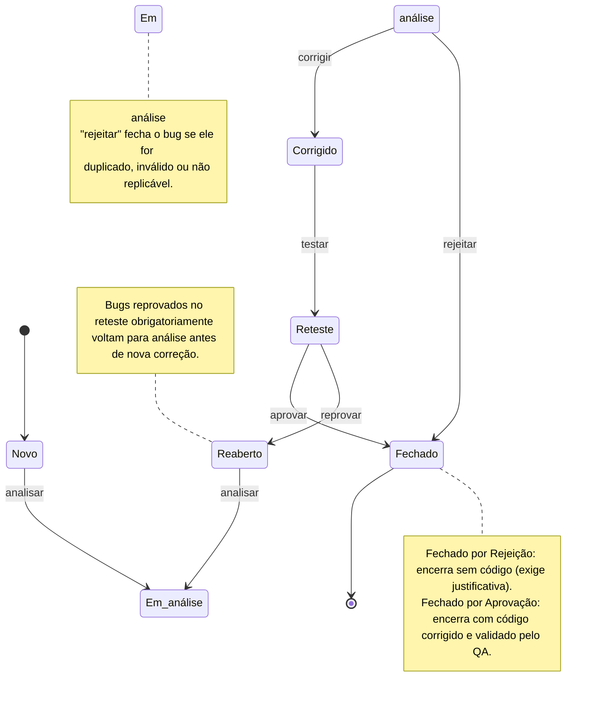

# Técnicas de caixa-preta

## 1. Partição de equivalência

### Sistema: cadastro de instrutor, campo "idade" (aceita de 18 a 65)

| Partição | Faixa | Tipo | Valor de teste | Resultado esperado |
|---|---|---|---|---|
| P1 | menor que 18 | inválido | 16 | Mensagem: "idade mínima permitida é de 18 anos" |
| P2 | de 18 a 65 | válido | 32 | Mensagem: "Cadastro realizado" |
| P3 | maior que 65 | inválido | 70 | Mensagem: "idade máxima permitida é de 65 anos" |

**Observação:** 32 anos foi escolhido por estar próximo do centro da faixa. Não foram usados 18 e 65 porque são valores de borda, que pertencem à análise de valor limite.

### Sistema: cadastro de senha, campo "senha" (aceita de 8 a 20 caracteres, com pelo menos 1 número)

| Partição | Faixa | Tipo | Valor de teste | Resultado esperado |
|---|---|---|---|---|
| P1 | menor que 8 | inválido | 123abc | Mensagem: "senha pequena, mínimo de 8 caracteres" |
| P2 | de 8 a 20, com número | válido | r2026claro5539 | Mensagem: "senha cadastrada com sucesso" |
| P3 | maior que 20 | inválido | batatinhafrita123batatinhafrita123 | Mensagem: "senha excede o limite, máximo de 20 caracteres" |
| P4 | de 8 a 20, sem número | inválido | abcdefghijklmno | Mensagem: "senha deve conter ao menos 1 número" |

**Observação:** a senha de 14 caracteres (r2026claro5539) foi escolhida como padrão empresarial, seguindo a estrutura [setor: r] + [ano: 2026] + [produto: claro] + [matrícula: 5539]. P2 e P4 têm o mesmo tamanho e diferem apenas pela presença de número. Não foram usados 8 e 20 caracteres porque são valores de borda, que pertencem à análise de valor limite.

### Sistema: desconto de compras (até R$ 100,00 = 0%; de R$ 100,01 a R$ 300,00 = 5%; acima de R$ 300,00 = 10%)

| Partição | Faixa | Tipo | Valor de teste | Resultado esperado |
|---|---|---|---|---|
| P1 | até 100,00 | 0% de desconto | 99,00 | Mensagem: "valor cobrado integralmente, sem desconto" |
| P2 | entre 100,01 e 300,00 | 5% de desconto | 150,00 | Mensagem: "você ganhou 5% de desconto" |
| P3 | acima de 300,00 | 10% de desconto | 310,00 | Mensagem: "você ganhou 10% de desconto" |

**Observação:** 150,00 foi escolhido por estar no meio da faixa de 5%. Não foram usados 100,01 e 300,01 porque são valores de borda, que pertencem à análise de valor limite.

## 2. Análise de valor limite

### Sistema: cadastro de instrutor, campo "idade" (aceita de 18 a 65)

| Valor | Posição | Resultado esperado | Justificativa |
|---|---|---|---|
| 17 | abaixo da faixa (a-1) | Mensagem: "idade mínima permitida é de 18 anos" | Valor logo abaixo da borda inferior. Se o código usar `>` no lugar de `>=`, a regra de 18 anos ficaria errada e o 18 seria recusado. Este caso confirma que o 17 é bloqueado. |
| 18 | borda inferior (a) | Mensagem: "Cadastro realizado" | Primeiro valor válido. Confirma que a borda inferior está incluída na faixa. |
| 65 | borda superior (b) | Mensagem: "Cadastro realizado" | Último valor válido. Confirma que a borda superior está incluída na faixa. |
| 66 | acima da faixa (b+1) | Mensagem: "idade máxima permitida é de 65 anos" | Valor logo acima da borda superior. Se o código usar `<` no lugar de `<=`, o 65 seria recusado. Este caso confirma que o 66 é bloqueado. |

### Sistema: cadastro de senha, campo "senha" (aceita de 8 a 20 caracteres, com pelo menos 1 número)

| Valor | Posição | Resultado esperado | Justificativa |
|---|---|---|---|
| 7 | abaixo da faixa (a-1) | Mensagem: "senha pequena, mínimo de 8 caracteres" | Valor logo abaixo da borda inferior. Se o código usar `>` no lugar de `>=`, a senha de 8 caracteres seria recusada. |
| 8 | borda inferior (a) | Mensagem: "senha cadastrada com sucesso" | Primeiro valor válido. Confirma que o tamanho mínimo está incluído. |
| 20 | borda superior (b) | Mensagem: "senha cadastrada com sucesso" | Último valor válido. Confirma que o tamanho máximo está incluído. |
| 21 | acima da faixa (b+1) | Mensagem: "senha excede o limite, máximo de 20 caracteres" | Valor logo acima da borda superior. Se o código usar `<` no lugar de `<=`, a senha de 20 caracteres seria recusada. |

### Sistema: desconto de compras (até R$ 100,00 = 0%; de R$ 100,01 a R$ 300,00 = 5%; acima de R$ 300,00 = 10%)

| Valor | Posição | Resultado esperado | Justificativa |
|---|---|---|---|
| 100,00 | borda superior da faixa 1 (0%) | Mensagem: "valor cobrado integralmente, sem desconto" | 100,00 pertence à faixa de 0%. Se o código usar `>` no lugar de `>=`, ele daria 5% aqui. |
| 100,01 | borda inferior da faixa 2 (5%) | Mensagem: "você ganhou 5% de desconto" | Primeiro valor da faixa de 5%. Confirma que o desconto começa no centavo correto. |
| 300,00 | borda superior da faixa 2 (5%) | Mensagem: "você ganhou 5% de desconto" | 300,00 pertence à faixa de 5%. Se o código usar `>` no lugar de `>=`, ele daria 10% aqui. |
| 300,01 | borda inferior da faixa 3 (10%) | Mensagem: "você ganhou 10% de desconto" | Primeiro valor da faixa de 10%. Confirma que a transição de faixa ocorre no centavo correto. |

## 3. Tabela de decisão

### DT1: frete

**Tabela completa (8 regras)**

| Condição | R1 | R2 | R3 | R4 | R5 | R6 | R7 | R8 |
|---|---|---|---|---|---|---|---|---|
| Compra ≥ R$ 200,00 | Sim | Sim | Sim | Sim | Não | Não | Não | Não |
| Cliente cadastrado | Sim | Sim | Não | Não | Sim | Não | Sim | Não |
| Interior | Sim | Não | Não | Sim | Sim | Sim | Não | Não |
| **Frete** | R$ 15 | R$ 0 | R$ 10 | R$ 25 | R$ 35 | R$ 35 | R$ 20 | R$ 20 |

**Tabela simplificada (6 regras)**

| Condição | R1 | R2 | R3 | R4 | R5 (antigas R5 e R6) | R6 (antigas R7 e R8) |
|---|---|---|---|---|---|---|
| Compra ≥ R$ 200,00 | Sim | Sim | Sim | Sim | Não | Não |
| Cliente cadastrado | Sim | Sim | Não | Não | - | - |
| Interior | Sim | Não | Não | Sim | Sim | Não |
| **Frete** | R$ 15 | R$ 0 | R$ 10 | R$ 25 | R$ 35 | R$ 20 |

**Justificativa da simplificação:** abaixo de R$ 200,00, o cadastro não altera o frete. Por isso R5 e R6 (cadastrado ou não, com interior) dão R$ 35 e foram unidas. R7 e R8 (cadastrado ou não, sem interior) dão R$ 20 e também foram unidas.

### DT2: reserva de equipamento

**Tabela completa (8 regras)**

| Condição | R1 | R2 | R3 | R4 | R5 | R6 | R7 | R8 |
|---|---|---|---|---|---|---|---|---|
| É professor? | Sim | Sim | Sim | Sim | Não | Não | Não | Não |
| Equipamento disponível? | Sim | Sim | Não | Não | Sim | Sim | Não | Não |
| Antecedência ≥ 24h? | Sim | Não | Sim | Não | Sim | Não | Sim | Não |
| **Status do pedido** | Aprovada | Coordenação | Recusada | Recusada | Coordenação | Coordenação | Recusada | Recusada |

**Tabela simplificada (4 regras)**

| Condição | R1 | R2 | R3 (antigas R5 e R6) | R4 (antigas R3, R4, R7 e R8) |
|---|---|---|---|---|
| É professor? | Sim | Sim | Não | - |
| Equipamento disponível? | Sim | Sim | Sim | Não |
| Antecedência ≥ 24h? | Sim | Não | - | - |
| **Status do pedido** | Aprovada | Coordenação | Coordenação | Recusada |

**Justificativa da simplificação:** para aluno com equipamento disponível, a antecedência não muda o resultado (sempre Coordenação), então R5 e R6 foram unidas. Para equipamento indisponível, o resultado é sempre Recusada, independentemente de quem pediu ou da antecedência, então R3, R4, R7 e R8 foram unidas.
# ST1: Reserva de Equipamento

## Matriz de Transição de Estados

| Estado/Evento | enviar | aprovar | recusar | retirar | devolver | atrasar | cancelar |
| :--- | :---: | :---: | :---: | :---: | :---: | :---: | :---: |
| **Rascunho** | Solicitada | — | — | — | — | — | Cancelada |
| **Solicitada** | — | Aprovada | Recusada | — | — | — | Cancelada |
| **Aprovada** | — | — | — | Em uso | — | — | Cancelada |
| **Recusada** | — | — | — | — | — | — | — |
| **Em uso** | — | — | — | — | Devolvida | Atrasada | — |
| **Atrasada** | — | — | — | — | Devolvida | — | — |
| **Devolvida** | — | — | — | — | — | — | — |
| **Cancelada** | — | — | — | — | — | — | — |

---

## Observações de Regras de Negócio & Governança

* **Propósito do Estado "Atrasada":** Quando um equipamento em atraso é entregue, o evento *devolver* o move diretamente para **Devolvida**. O estado intermediário **Atrasada** existe estritamente para fins de governança:
  1. **Bloqueio de novas ações:** Impede o professor com pendências de abrir novas solicitações no sistema.
  2. **Automação de Alertas:** Dispara e-mails diários de cobrança ao usuário e notificações para a gerência de TI.
  3. **Métricas de Auditoria:** Permite extrair relatórios de conformidade e tempo de retenção irregular de itens do inventário da escola.
* **Gatilho de Atraso:** O evento *atrasar* é uma ação automatizada e executada de forma nativa pelo sistema (via rotina agendada/cron job) assim que o prazo limite da reserva expira, não dependendo de interação humana.
* **Regra de Cancelamento:** O evento *cancelar* é permitido exclusivamente antes da retirada física do equipamento (**Rascunho**, **Solicitada** e **Aprovada**). Uma vez em posse do usuário (**Em uso** ou **Atrasada**), o fluxo não pode ser cancelado, apenas finalizado via devolução.
* **Ciclo de Vida do Rascunho:** O estado **Rascunho** representa uma intenção local do usuário e não é computado como uma reserva real pelo inventário da escola até que o evento *enviar* seja acionado.
* **Estados Terminais:** Os estados **Recusada**, **Devolvida** e **Cancelada** encerram o ciclo de vida da reserva. Neles, qualquer tentativa de evento resultará em uma transição inválida (`—`).

## Diagrama de Estados do ST1 (Mermaid)

### Casos de transição válidos (ST1)

| ID | Estado inicial | Evento | Estado esperado | Tipo |
|---|---|---|---|---|
| CT-01 | Rascunho | enviar |  Solicitada | Válida |
| CT-02 | Rascunho | cancelar |  Cancelada | Válida |
| CT-03 | Solicitada | aprovar |  Aprovada | Válida |
| CT-04 | Solicitada | recusar |  Recusada | Válida |
| CT-05 | Solicitada | cancelar |  Cancelada | Válida |
| CT-06 | Aprovada | retirar |  Em uso | Válida |
| CT-07 | Aprovada | cancelar |  Cancelada | Válida |
| CT-08 | Em uso | devolver |  Devolvida | Válida |
| CT-09 | Em uso | atrasar |  Atrasada | Válida |
| CT-10 | Atrasada | devolver |  Devolvida | Válida |

### Casos de transição inválidos (ST1)

| ID | Estado inicial | Evento | Estado esperado | Tipo |
|---|---|---|---|---|
| CT-11 | Solicitada | enviar |  bloqueado | Inválida |
| CT-12 | Aprovada | devolver |  bloqueado | Inválida |
| CT-13 | Recusada | retirar |  bloqueado | Inválida |
| CT-14 | Em uso | aprovar |  bloqueado | Inválida |
| CT-15 | Atrasada | retirar |  bloqueado | Inválida |
| CT-16 | Devolvida | cancelar |  bloqueado | Inválida |

### Justificativas de Transições Inválidas (ST1)

#### Fluxo Prematuro (Ações antes da hora)
* **CT-11 (Solicitada ➔ enviar):** Bloqueado. Não se pode enviar o que não foi aprovado primeiro.
* **CT-12 (Aprovada ➔ devolver):** Bloqueado. Não se pode devolver o que ainda não foi retirado.

#### Violação de Regra/Segurança (Ações proibidas)
* **CT-13 (Recusada ➔ retirar):** Bloqueado. Pedido negado não dá direito a retirada.
* **CT-15 (Atrasada ➔ retirar):** Bloqueado. Usuário em atraso não pode retirar mais nada (ou o item já está com ele).

#### Ações Redundantes (Fase atual já passou)
* **CT-14 (Em uso ➔ aprovar):** Bloqueado. O item já está sendo usado, não precisa de nova aprovação.

#### Ciclo Já Finalizado (Ações tardias)
* **CT-16 (Devolvida ➔ cancelar):** Bloqueado. O processo já terminou, não dá mais para cancelar.

# ST2: Ciclo de Vida do Bug

## Matriz de Transição de Estados

| Estado/Evento | relatar | analisar | rejeitar | corrigir | testar | reprovar | aprovar |
| :--- | :---: | :---: | :---: | :---: | :---: | :---: | :---: |
| **Novo** | — | Em análise | — | — | — | — | — |
| **Em análise** | — | — | Fechado | Corrigido | — | — | — |
| **Corrigido** | — | — | — | — | Reteste | — | — |
| **Reteste** | — | — | — | — | — | Reaberto | Fechado |
| **Fechado** | — | — | — | — | — | — | — |
| **Reaberto** | — | Em análise | — | — | — | — | — |

---

## Observações de Regras de Negócio & Governança

* **Tratamento de Bugs Inválidos (Evento "rejeitar"):** Nem todo bug relatado necessita de correção no código. No estado **Em análise**, o desenvolvedor tem a prerrogativa de acionar o evento *rejeitar*. Isso move o bug diretamente para **Fechado** sob justificativas específicas mapeadas pelo sistema (ex: "Não replicável", "Comportamento esperado/Duplicado" ou "Arquitetura original").
* **Fluxo de Falha no Teste (Reabertura):** Se o erro persistir durante a etapa de **Reteste**, o analista de QA executa o evento *reprovar*, o que joga o item para **Reaberto**. A partir de **Reaberto**, a única ação sistêmica válida é *analisar*, garantindo que o bug retorne para a esteira de triagem técnica antes de qualquer nova tentativa de correção.
* **Ciclo de Encerramento Limpo (Remoção do Arquivamento):** O estado **Fechado** atua como o estado terminal definitivo do ciclo de vida do bug, alcançado tanto pela aprovação do reteste quanto pela rejeição justificada na análise. Nenhuma transição subsequente é permitida a partir dele.
* **Consistência de Nomenclatura:** Todos os estados seguem o padrão nominal estabelecido para mapeamento idêntico nas interfaces visuais do sistema e nos scripts automatizados de testes de caixa preta.
* **Distinção Técnica do Estado "Fechado" (Rejeição vs. Aprovação):**
**Fechado por Rejeição (Triagem):** O item encerra o ciclo de vida sem alteração de código. O sistema exige uma justificativa de descarte (ex: duplicado, inválido) para fins de auditoria e cálculo de taxa de rejeição (rejection rate) do time.

**Fechado por Aprovação (QA):** O item encerra o ciclo após implementação de código e validação funcional bem-sucedida. O sistema vincula os relatórios de teste e marca a build/versão de release onde o fix foi publicado.

## Diagrama de Estados do ST2 (Mermaid)

### Casos de transição válidos (ST2)

| ID | Estado inicial | Evento | Estado esperado | Tipo |
|---|---|---|---|---|
| CT-01 | Novo | analisar |  Em análise | Válida |
| CT-02 | Em análise | rejeitar |  Fechado | Válida |
| CT-03 | Em análise | corrigir |  Corrigido | Válida |
| CT-04 | Corrigido | testar |  Reteste | Válida |
| CT-05 | Reteste | reprovar |  Reaberto | Válida |
| CT-06 | Reteste | aprovar |  Fechado | Válida |
| CT-07 | Reaberto | analisar |  Em análise | Válida |

### Casos de transição inválidos (ST2)

| ID | Estado inicial | Evento | Estado esperado | Tipo |
|---|---|---|---|---|
| CT-08 | Novo | testar |  bloqueado | Inválida |
| CT-09 | Em análise | testar |  bloqueado | Inválida |
| CT-10 | Corrigido | aprovar |  bloqueado | Inválida |
| CT-11 | Fechado | testar |  bloqueado | Inválida |

### Justificativas de Transições Inválidas (ST2)

#### Fluxo Prematuro (Ações antes da hora)
* **CT-08 (Novo ➔ testar):** Bloqueado. O erro acabou de ser criado e ainda não recebeu manutenção. Não há correção disponível para ser testada.
* **CT-09 (Em análise ➔ testar):** Bloqueado. O problema ainda está sendo investigado ou desenvolvido. O teste só pode ocorrer após o código ser alterado.

#### Fluxo Pulado (Etapa obrigatória ausente)
* **CT-10 (Corrigido ➔ aprovar):** Bloqueado. Um item corrigido precisa obrigatoriapente passar pela validação/teste do QA antes de receber a aprovação final.

#### Ciclo Já Finalizado (Ações tardias)
* **CT-11 (Fechado ➔ testar):** Bloqueado. O ticket está encerrado. Testes não podem ser executados em registros históricos finalizados.
