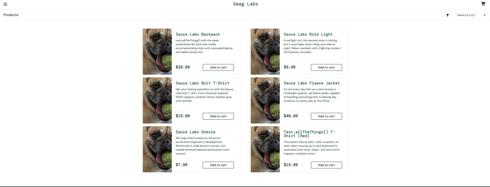
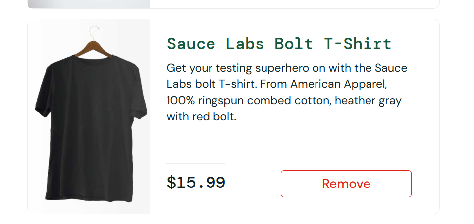
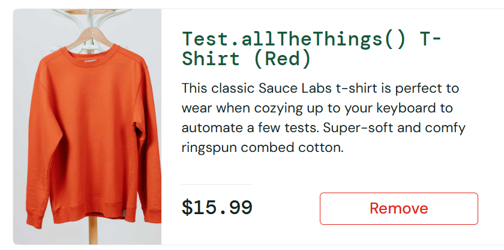

# verificação funcional

* É testar o que o sistema faz, comparando o comportamento com o que foi pedido. Cada verificação tem três partes: a ação (o que você faz), o resultado esperado (o que deveria acontecer) e o resultado obtido (o que de fato aconteceu).

### Roteiro de 33 verificações (SauceDemo)

| Bloco | Quantidade | Foco |
|---|---|---|
| Login | 6 | Credenciais válidas, inválidas, campos vazios, locked_out_user |
| listagem | 8 | Ordenação (nome e preço), exibição de produtos, detalhe do item |
| Carrinho | 6 | Adicionar, remover, quantidade, total, persistência ao navegar |
| Checkout | 6 | Dados obrigatórios, cálculo de total, confirmação do pedido |
| Bugs de propósito | 6 | Comportamentos dos usuários problem_user e error_user |

| ID | Funcionalidade | Pré-condição | Ação | Resultado esperado | Resultado obtido | Status |
|---|---|---|---|---|---|---|
| VF-01 | Login | Usuário standard_user cadastrado | Digitar standard_user e secret_sauce e clicar em Login | Redirecionar para a página de produtos |  Foi redirecionado para a pagina de Products | Passou |
| VF-02 | Login | Usuário locked_out_user cadastrado | Digitar locked_out_user e secret_sauce e clicar em Login | Exibir mensagem de usuário bloqueado e não redirecionar | A mensagem de usuário bloqueado foi exibida e não houve redirecionamento | Passou |
| VF-03 | Login | Usuário standard_user cadastrado | Digitar standard_user e teste_sauce e clicar em Login | Exibir mensagem de credenciais invalidas | Epic sadface: Username and password do not match any user in this service | Passou |
| VF-04 | Login | Página de login aberta | Deixar o campo usuário vazio, digitar secret_sauce e clicar em Login | Exibir mensagem de Username obrigatorio | Epic sadface: Username is required | Passou |
| VF-05 | Login | Usuário standard_user cadastrado | Digitar standard_user, deixar o campo senha vazio e clicar em Login | Exibir mensagem de Password obrigatorio | Epic sadface: Password is required | Passou |
| VF-06 | Login | Usuário problem_user cadastrado | Digitar problem_user e secret_sauce e clicar em Login | Redirecionar para a página de produtos | Redirecionado para Products, mas todas as imagens dos 6 produtos exibem o mesmo cachorro pug (ex.: Sauce Labs Backpack, Bike Light, Onesie). Evidência: | Falhou |
| VF-07 | Listagem | Tela inicial Products | Ordenar o Products com Price (low to high) | Produtos ordenados por preço do menor para o maior | Primeiro item: Sauce Labs Onesie ($7.99); Ultimo: Sauce Labs Fleece Jacket ($49.99) | Passou |
| VF-08 | Listagem | Tela inicial Products | Ordenar o Products com Price (high to low) | Produtos ordenados por preço do maior para o menor | Primeiro item: Sauce Labs Fleece Jacket ($49.99); Ultimo: Sauce Labs Onesie ($7.99) | Passou |
| VF-09 | Listagem | Tela inicial Products | Ordenar o Products com Name (A to Z) | Produtos ordenados pelo nome de A - Z | Primeiro item: Sauce Labs Backpack ($29.99); Ultimo: Test.allTheThings() T-Shirt (Red) ($15.99) | Passou |
| VF-10 | Listagem | Tela inicial Products | Ordenar o Products com Name (Z to A) | Produtos ordenados pelo nome de Z - A | Primeiro item: Test.allTheThings() T-Shirt (Red) ($15.99); Ultimo: Sauce Labs Backpack ($29.99) | Passou |
| VF-11 | Listagem | Tela inicial Products | Clicar em um produto (ex.: Sauce Labs Backpack) | Redirecionar para a pagina do produto | Foi redirecionado para a página do produto (nome, descrição e valor estão corretos) | Passou |
| VF-12 | Listagem | Usuário standard_user logado | Observar a imagem e o preço de cada um dos 6 produtos | Cada produto exibe imagem própria e preço correspondente | Todos os produtos tem foto e valor individuais correspondente | Passou |
| VF-13 | Listagem | Usuário standard_user logado | Observar (imagem, nome e descrição do produto)  | imagem, nome e descrição condizentes com o produto | Produto Sauce Labs Bolt T-Shirt tem descrição de camiseta cinza com bolt vermelho, mas a imagem exibida é de uma camisa preta. Evidência: | Falhou |
| VF-14 | Listagem | Usuário standard_user logado | Observar (imagem, nome e descrição do produto)  | imagem, nome e descrição condizentes com o produto | Produto Test.allTheThings() T-Shirt (Red)” foge do padrão “Sauce Labs ...". Evidência: | Falhou |
| VF-15 |
| VF-16 |
| VF-17 |
| VF-18 |
| VF-19 |
| VF-20 |
| VF-21 |
| VF-22 |
| VF-23 |
| VF-24 |
| VF-25 |
| VF-26 |
| VF-27 |
| VF-28 |
| VF-29 |
| VF-30 |
