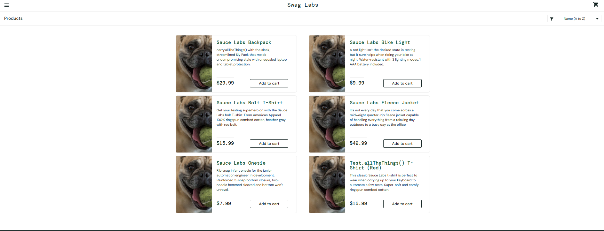
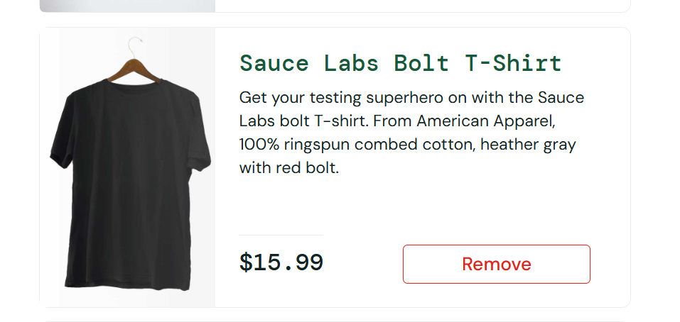
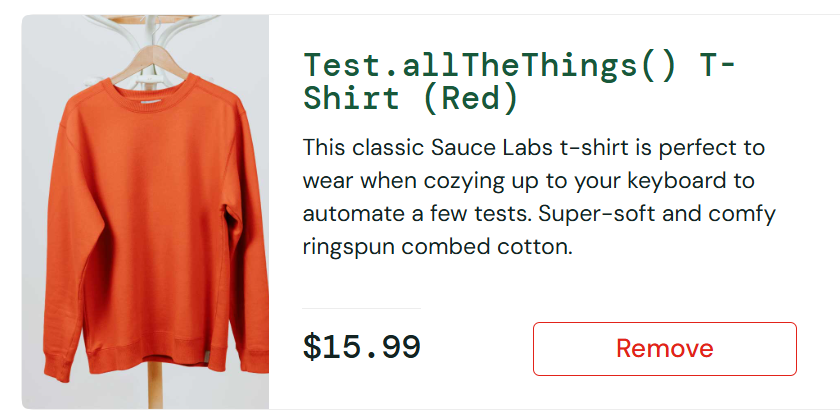

# verificação funcional

* É testar o que o sistema faz, comparando o comportamento com o que foi pedido. Cada verificação tem três partes: a ação (o que você faz), o resultado esperado (o que deveria acontecer) e o resultado obtido (o que de fato aconteceu).

### Roteiro de 33 verificações (SauceDemo)

| Bloco | Quantidade | Foco |
|---|---|---|
| Login | 6 | Credenciais válidas, inválidas, campos vazios, locked_out_user |
| listagem | 8 | Ordenação (nome e preço), exibição de produtos, detalhe do item |
| Carrinho | 6 | Adicionar, remover, quantidade, total, persistência ao navegar |
| Checkout | 6 | Dados obrigatórios, cálculo de total, confirmação do pedido |
| Bugs de propósito | 6 | Comportamentos dos usuários problem_user e error_user |

| ID | Funcionalidade | Pré-condição | Ação | Resultado esperado | Resultado obtido | Status |
|---|---|---|---|---|---|---|
| VF-01 | Login | Usuário standard_user cadastrado | Digitar standard_user e secret_sauce e clicar em Login | Redirecionar para a página de produtos |  Foi redirecionado para a página de Products | Passou |
| VF-02 | Login | Usuário locked_out_user cadastrado | Digitar locked_out_user e secret_sauce e clicar em Login | Exibir mensagem de usuário bloqueado e não redirecionar | A mensagem de usuário bloqueado foi exibida e não houve redirecionamento | Passou |
| VF-03 | Login | Usuário standard_user cadastrado | Digitar standard_user e teste_sauce e clicar em Login | Exibir mensagem de credenciais invalidas | Epic sadface: Username and password do not match any user in this service | Passou |
| VF-04 | Login | Página de login aberta | Deixar o campo usuário vazio, digitar secret_sauce e clicar em Login | Exibir mensagem de Username obrigatorio | Epic sadface: Username is required | Passou |
| VF-05 | Login | Usuário standard_user cadastrado | Digitar standard_user, deixar o campo senha vazio e clicar em Login | Exibir mensagem de Password obrigatorio | Epic sadface: Password is required | Passou |
| VF-06 | Login | Usuário problem_user cadastrado | Digitar problem_user e secret_sauce e clicar em Login | Redirecionar para a página de produtos | Redirecionado para Products, mas todas as imagens dos 6 produtos exibem o mesmo cachorro pug (ex.: Sauce Labs Backpack, Bike Light, Onesie). Evidência: | Falhou |
| VF-07 | Listagem | Tela inicial Products | Ordenar o Products com Price (low to high) | Produtos ordenados por preço do menor para o maior | Primeiro item: Sauce Labs Onesie ($7.99); Ultimo: Sauce Labs Fleece Jacket ($49.99) | Passou |
| VF-08 | Listagem | Tela inicial Products | Ordenar o Products com Price (high to low) | Produtos ordenados por preço do maior para o menor | Primeiro item: Sauce Labs Fleece Jacket ($49.99); Ultimo: Sauce Labs Onesie ($7.99) | Passou |
| VF-09 | Listagem | Tela inicial Products | Ordenar o Products com Name (A to Z) | Produtos ordenados pelo nome de A - Z | Primeiro item: Sauce Labs Backpack ($29.99); Ultimo: Test.allTheThings() T-Shirt (Red) ($15.99) | Passou |
| VF-10 | Listagem | Tela inicial Products | Ordenar o Products com Name (Z to A) | Produtos ordenados pelo nome de Z - A | Primeiro item: Test.allTheThings() T-Shirt (Red) ($15.99); Ultimo: Sauce Labs Backpack ($29.99) | Passou |
| VF-11 | Listagem | Tela inicial Products | Clicar em um produto (ex.: Sauce Labs Backpack) | Redirecionar para a página do produto | Foi redirecionado para a página do produto (nome, descrição e valor estão corretos) | Passou |
| VF-12 | Listagem | Usuário standard_user logado | Observar a imagem e o preço de cada um dos 6 produtos | Cada produto exibe imagem própria e preço correspondente | Todos os produtos tem foto e valor individuais correspondente | Passou |
| VF-13 | Listagem | Usuário standard_user logado | Observar (imagem, nome e descrição do produto)  | imagem, nome e descrição condizentes com o produto | Produto Sauce Labs Bolt T-Shirt tem descrição de camiseta cinza com bolt vermelho, mas a imagem exibida é de uma camisa preta. Evidência: | Falhou |
| VF-14 | Listagem | Usuário standard_user logado | Observar (imagem, nome e descrição do produto)  | imagem, nome e descrição condizentes com o produto | Produto Test.allTheThings() T-Shirt (Red)” foge do padrão “Sauce Labs ...". Evidência: | Falhou |
| VF-15 | Carrinho | standard_user logado, carrinho vazio | Clicar em “Add to cart” no Sauce Labs Backpack | Ícone do carrinho mostra 1 item e o botão muda para “Remove” | Ícone mostrando 1 e botão alterado para "Remove" | Passou |
| VF-16 | Carrinho | standard_user logado, carrinho vazio | Adicionar Backpack, Bike Light e Onesie | Ícone do carrinho mostra 3 | Ícone no valor correto (3) | Passou |
| VF-17 | Carrinho | 1 item no carrinho | Clicar em “Remove” no item adicionado | Ícone some ou mostra 0, e o botão volta para “Add to cart” | Ícone do carrinho sem número (ou vazio) e botão ‘Add to cart’ restaurado | Passou |
| VF-18 | Carrinho | standard_user logado, 3 itens no carrinho | Abrir o carrinho e conferir a lista | Os 3 itens aparecem com nome, descrição e preço corretos | Três itens listados: Sauce Labs Onesie ($7.99), Sauce Labs Backpack ($29.99) e Sauce Labs Bike Light ($9.99). Nome, descrição e preço conferem com a listagem.” Descrições longas não precisam estar na tabela; use o nome e o preço | Passou |
| VF-19 | Carrinho | Itens no carrinho | Abrir o carrinho, clicar em “Continue Shopping” e voltar | Os itens continuam no carrinho | Os itens continuam no carrinho apos voltar a listagem | passou |
| VF-20 | Carrinho | Carrinho com itens | Adicionar um item, recarregar a página (F5) | O item permanece no carrinho | O item permaneceu no carrinho após o F5 | Passou |
| VF-21 | Carrinho | Carrinho com 1 item | Remover o item dentro da tela do carrinho | Item removido da lista e contador atualizado | Item removido da lista e contador atualizado para o novo total (0 ou o número restante) | Passou |
| VF-22 | Carrinho | Carrinho com itens do problem_user | Logar com problem_user e adicionar 1 item | Item adicionado e contador correto | Três itens não puderam ser adicionados (Sauce Labs Bolt T-Shirt, Sauce Labs Fleece Jacket e Test.allTheThings() T-Shirt (Red)). Os demais entraram e o contador acompanhou a quantidade. A remoção não funcionou na listagem principal, apenas dentro do carrinho. | Falhou |
| VF-23 | Checkout | standard_user logado, 3 itens no carrinho | Clicar em "Checkout" | Tela "Your Information" com campos First Name, Last Name e Postal Code | Tela "Checkout: Your Information" com os campos fist_name,last_name e zip/postal_code | Passou |
| VF-24 | Checkout | Tela "Your Information" aberta, campos vazios | Clicar em "Continue" sem preencher nada | Mensagem "Error: First Name is required" | Mensagem "Error: First Name is required" exibida | Passou |
| VF-25 | Checkout | Tela "Your Information" aberta | Preencher First Name e Postal Code, deixar Last Name vazio e clicar em "Continue" | Mensagem "Error: Last Name is required" | Mensagem "Error: Last Name is required" exibida | Passou |
| VF-26 | Checkout | Campos preenchidos corretamente | Clicar em "Continue" | Tela "Checkout: Overview" com os 3 itens e o total | Tela "Checkout: Overview" exibindo os itens Sauce Labs Onesie ($7.99), Sauce Labs Backpack ($29.99) e Sauce Labs Bike Light ($9.99) | Passou |
| VF-27 | Checkout | Tela "Checkout: Overview" aberta | Conferir Item total, Tax e Total | Item total = soma dos preços; Total = Item total + Tax | Item total: $47.97 (soma esperada: $47.97). Tax: $3.84. Total: $51.81. Confirma a regra | Passou |
| VF-28 | Checkout | Tela "Checkout: Overview" aberta | Clicar em "Finish" | Tela "Thank you for your order!" e contador do carrinho zerado | Após "Finish", a tela exibiu "Thank you for your order!" e o contador do carrinho mostrou 0 | Passou |
| VF-29 | Bugs de propósito | problem_user logado | Abrir a página de produtos e observar as imagens | Cada produto exibe imagem própria (contraponto do VF-06) | Todas as imagens dos 6 produtos exibem o mesmo cachorro pug (ex.: Sauce Labs Backpack, Bike Light, Onesie). Imagens repetidas, como no BUG-01 | Falhou |
| VF-30 | Bugs de propósito | problem_user logado | Abrir o detalhe de um produto (ex.: Sauce Labs Backpack) | Imagem e descrição correspondem ao produto | A imagem e a descrição do Sauce Labs Backpack correspondem ao produto | Passou |
| VF-31 | Bugs de propósito | problem_user logado, Sauce Labs Bolt T-Shirt, Sauce Labs Fleece Jacket e Test.allTheThings() T-Shirt (Red) | Adicionar ao carrinho os três itens | Os três itens entram no carrinho e o contador aumenta | Os três itens não entraram no carrinho. Referência: BUG-04 | Falhou |
| VF-32 | Bugs de propósito | problem_user logado, com item no carrinho | Abrir o carrinho e tentar remover um item na listagem principal | Remoção funciona na listagem, com contador atualizado | Botão “Remove” travado na listagem principal: o item não é removido e o contador não muda. A remoção só funciona dentro do carrinho. Referência: BUG-04| Falhou |